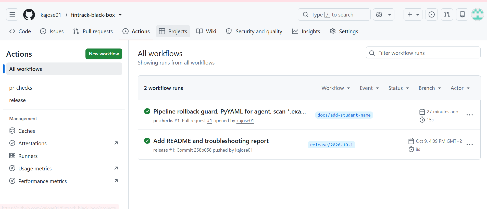

# FinTrack: Kubernetes & Docker Black Box Challenge (Assignment #2, "Release Night Chaos")

**Student:** KANKERA JOSEPHINE
**Assignment:** Assignment #2, Release Night Chaos: Stabilizing Hypergrowth Infra (Skillfyme DevOps Program)
**Platform:** AWS EC2 (Ubuntu), Docker, k3s, Istio, Jenkins, GitHub Actions

## 1. Problem statement
FinTrack shipped a release at 11:59 PM with env-var feature toggles, a canary of `account-service:v2`, a Jenkins multi-stage pipeline and an Istio mesh. By morning: canary stuck at 100%, OOMKilled services, hung Jenkins agents, unapproved merges, CrashLoopBackOff / ImagePullBackOff / Pending pods, silent alerting, failed rollback (tag mismatch) and secrets committed to Git. Stabilize, secure and optimize in 4 phases without rebuilding from scratch.

## 2. Solution approach
| Phase | What was done | Where |
|---|---|---|
| 1 Git hygiene | bisect/revert/reflog on a reproduced bad release; secret purge + rotation; branch protection + CODEOWNERS; `release/YYYY.MM.N` tags; auto changelog; pre-commit/pre-push secret hooks **plus the same scan as a required CI check** | `scripts/phase1-simulate.sh`, `scripts/secret-scan.sh`, `.githooks/`, `.github/`, `scripts/protect-branch.sh`, `scripts/changelog.sh` |
| 2 Jenkins | agent diagnosis (disk/overload/disconnect), resource-bounded controller + agent with auto-restart, pipeline with timeouts, notifications, approval gate, Istio-5xx rollback; rollback uses a recorded `last_good_image` (fixes tag mismatch); JCasC users + credentials | `Jenkinsfile`, `jenkins/`, `scripts/jenkins-diagnose.sh`, `scripts/rollback.sh`, `scripts/mark-release.sh` |
| 3 K8s resilience | OOMKilled / ImagePull / Pending reproduced and fixed; limits, probes, `progressDeadlineSeconds`; Mongo StatefulSet storage + anti-affinity fix; ResourceQuota + LimitRange; canary label/subset fix; fault injection | `k8s/`, `broken/`, `chaos/`, `scripts/fault-injection.sh` |
| 4 Istio | STRICT mTLS; 90/10 canary; retries(2)+timeout(3s) everywhere; circuit breaker on payment-service; Jaeger tracing frontend -> account -> payment; latency found and removed | `istio/`, `scripts/canary-guard.sh` |
| Bonus | Jenkins agent crash, secret hook bypass, 100% buggy canary; prevention designs | `scripts/chaos.sh`, `scripts/reconcile.sh`, `docs/REPORT.md` |

Details, diagnosis commands and prevention measures: **[docs/REPORT.md](docs/REPORT.md)**.

## 3. Dependencies / setup
- EC2 Ubuntu (recommended t3.xlarge: 4 vCPU / 16 GB, 40 GB disk), Docker + k3s (`scripts/01` from the previous assignment, or `curl -sfL https://get.k3s.io | sh -`)
- Istio (installed by `scripts/install-istio.sh`), `gh` CLI for branch protection (optional)

## 4. Execution steps
```bash
./scripts/install-hooks.sh                     # Phase 1 hooks
./scripts/build-images.sh                      # fintrack/app:v1 and :v2 -> k3s
./scripts/install-istio.sh                     # Istio + Prometheus + Jaeger
./scripts/deploy-all.sh                        # namespace, quota, mongo, services, Istio routing
./scripts/test-traffic.sh 100                  # ~90/10 split across v1/v2
./scripts/phase1-simulate.sh                   # Phase 1 walkthrough
kubectl apply -f broken/oom-ledger.yaml        # Phase 3 failures (see REPORT)
./scripts/fault-injection.sh                   # Phase 3 fault injection + recovery
./scripts/chaos.sh canary-100                  # Bonus 3
```
App entry point: `http://<EC2 public IP>:30090` (Istio ingress gateway). Jaeger: `kubectl -n istio-system port-forward svc/tracing 16686:80`.

## 5. Notes
No secrets are stored in Git (`mongo-credentials` is generated on the cluster; Jenkins secrets come from an ignored `.env`).
Istio has no "5 failures per 60 s window" primitive; the circuit breaker uses `consecutive5xxErrors: 5` with a 60 s ejection.

## 6. Screenshots
**Phase 1: CI checks and release workflow (green)**

